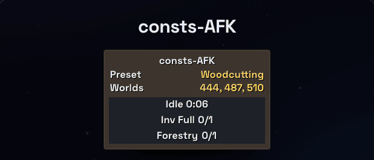

# consts-osrs

RuneLite plugins for Old School RuneScape ( OSRS ), by const. One Gradle build, one plugin per folder.

| Plugin | What it does |
|---|---|
| [consts-AFK](consts-afk/) | OSRS AFK alerts with presets for chinning, crabbing, mining, woodcutting, fishing and salvaging, Forestry events included: beeps, screen flashes and a status panel. |
| [consts-Destination](consts-destination/) | Lights up the tile and anything you hover that you can act on, keeps what you clicked lit until you're done, and draws tile packs, marked tiles for content all over the game. Folds in RuneLite's Interact Highlight and Tile Packs. |
| [consts-Leaderboard](consts-leaderboard/) | Any player's skills from the hiscores in a sidebar panel: right-click and Lookup, or one button for your own. Levels stop at 99: a 99 is yellow, the lowest skill red. Cut down from RuneLite's HiScore. |
| [consts-World](consts-world/) | A world switcher that opens on your hot list: star the worlds you hop between once, then hop with a click. Search and sort either tab, the hot list or all worlds, by activity, number or region. Starts you back on the world you were last on. Cut down from RuneLite's World Hopper. |



More at [constdecimalserrno.dev/consts-osrs](https://constdecimalserrno.dev/consts-osrs/).

## Run it

The plugins aren't on the Plugin Hub yet, so you run RuneLite from this repo with every plugin loaded.

### Prerequisites

- **JDK 17+** to run Gradle
- **JDK 11** for the RuneLite client (Temurin 11 works)
- **RuneLite** installed from [runelite.net](https://runelite.net)

`run.sh` defaults to the Homebrew OpenJDK and Temurin 11 paths on macOS. Anywhere else, point it at your JDKs:

```bash
export JAVA_HOME=/path/to/jdk-17          # runs Gradle
export RUNELITE_JAVA_HOME=/path/to/jdk-11 # runs the client
```

### Jagex accounts (one time)

A client started from source can't log in through the Jagex Launcher by itself. Let the launcher hand it your session once:

1. Open RuneLite's configure mode (`RuneLite --configure`; on macOS `/Applications/RuneLite.app/Contents/MacOS/RuneLite --configure`).
2. Add the client argument `--insecure-write-credentials` and save.
3. Launch RuneLite from the Jagex Launcher and log in once.

RuneLite writes `~/.runelite/credentials.properties`, and the client started from source logs in with it. Treat that file like a password.

### Launch

```bash
./run.sh all        # tests, compile, launch RuneLite with every plugin
./run.sh runClient  # launch only
./run.sh test       # tests only
```

The plugin shows up in RuneLite's plugin list. Its settings live under the wrench.

## Releases

Each [release](https://github.com/constdecimalserrno/consts-osrs/releases) attaches a compiled plugin jar. Plugins are versioned and tagged on their own: `consts-destination-v1.0.0`, and consts-AFK from `consts-afk-v1.8.0` on (its earlier releases are tagged `v1.0.0` to `v1.7.0`). Build them yourself with `./gradlew jar`; they land in `<plugin>/build/libs/`.

## Project structure

```
consts-osrs/
├── build.gradle                  # Shared config: Java 11, RuneLite, tests
├── settings.gradle               # One include per plugin
├── run.sh                        # Build and launch
├── scripts/publish-hub-branch.sh # Cut a plugin's Plugin Hub branch
├── src/test/java/com/osrs/
│   └── PluginLauncher.java       # Loads every plugin into one RuneLite client
├── consts-afk/
│   ├── runelite-plugin.properties  # Plugin Hub metadata
│   ├── icon.png                    # Plugin Hub icon, 48×72
│   └── src/main/java/com/constsafk/...
├── consts-destination/
│   ├── runelite-plugin.properties
│   ├── icon.png
│   └── src/main/java/com/constsdestination/...
├── consts-leaderboard/
│   ├── runelite-plugin.properties
│   ├── icon.png
│   └── src/main/java/com/constsleaderboard/...
└── consts-world/
    ├── runelite-plugin.properties
    ├── icon.png
    └── src/main/java/com/constsworld/...
```

Each plugin is a Gradle subproject with its own version. Shared settings live in the root `build.gradle`; a plugin's own `build.gradle` holds its `version` and any overrides.

## Plugin Hub

The Plugin Hub builds a plugin only from the root of a repo, so each plugin gets its own branch, `plugin-hub/<plugin>`, holding just its folder. `scripts/publish-hub-branch.sh consts-afk` cuts it from `main` with `git subtree split`, pushes it, and prints the `repository=` and `commit=` lines for the plugin's manifest in [runelite/plugin-hub](https://github.com/runelite/plugin-hub). The Hub replaces the plugin's `build.gradle` (`build=standard`), so a plugin may only depend on RuneLite itself.

## Adding a plugin

1. Create `new-plugin/src/main/java/com/newplugin/` and `new-plugin/src/test/java/com/newplugin/`.
2. Add `new-plugin/build.gradle` (a comment is enough).
3. Add `include 'new-plugin'` to `settings.gradle` and `implementation project(':new-plugin')` to the root `build.gradle` dependencies.
4. Write `NewPlugin.java` (extends `Plugin`, has `@PluginDescriptor`) and `NewPluginConfig.java` (extends `Config`, has `@ConfigGroup`).
5. Add `NewPlugin.class` to `ExternalPluginManager.loadBuiltin(...)` in `PluginLauncher.java`, and give the plugin its own `new-plugin/runelite-plugin.properties` (copy consts-afk's).
6. `./run.sh all`.

## License

[MIT](LICENSE). Each plugin folder carries its own copy, because the Plugin Hub builds a plugin from its folder alone. Code ported from RuneLite plugins keeps its BSD 2-Clause license: NPC Aggression Timer by Woox in consts-AFK ([NOTICE](consts-afk/NOTICE)), Interact Highlight by Adam in consts-Destination ([NOTICE](consts-destination/NOTICE)), the Configuration panel by Adam in both, as their sidebar settings, HiScore by Adam, Psikoi and Bram91 in consts-Leaderboard ([NOTICE](consts-leaderboard/NOTICE)) and World Hopper by Adam, Lotto, gregg1494 and Psikoi, with a part of Default World by Tomas Slusny, in consts-World ([NOTICE](consts-world/NOTICE)). So does the Plugin Hub's [Tile Packs](https://github.com/TrevorMDev/tile-packs) by TrevorMDev, folded into consts-Destination (same NOTICE).

Not affiliated with Jagex or RuneLite. Old School RuneScape is a trademark of Jagex Ltd.
