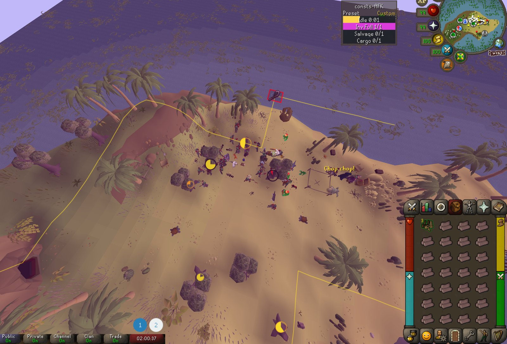
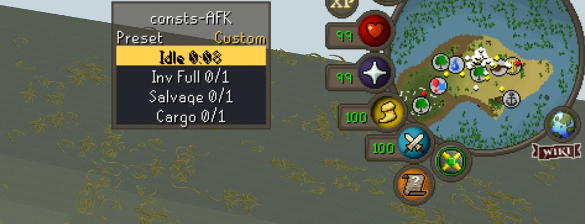
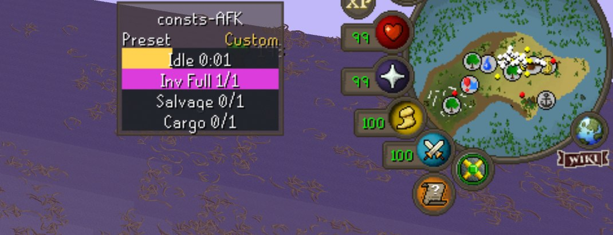

# consts-AFK

RuneLite plugin for AFK play in Old School RuneScape ( OSRS ): chinning, crabbing, mining, woodcutting, fishing and salvaging. Each alert beeps, flashes the screen in its own color, and shows up as a bar in a top-right status panel. Pick a preset and only the alerts you need are on.

| Idle | Inventory full |
|---|---|
|  |  |

Formerly **AFK Alerts**. Saved settings carry over: the config group is still `afkcombatalerts`.

## Presets

The **Preset** dropdown sits at the very top of the plugin config. You can also right-click the status panel and choose `Preset: …`.

| Preset | Alerts on |
|---|---|
| Custom (default) | Whatever each alert's own on/off says |
| Chinning | Health, Prayer, Potion, Aggro, Logout |
| Crabbing | Health, Idle, Aggro, Logout, Potion |
| Mining | Idle, Inventory Full |
| Woodcutting | Idle, Inventory Full, Forestry |
| Fishing | Idle, Inventory Full |
| Salvaging Active | Inventory Full, Salvage |
| Salvaging AFK | Cargo Hold only |

Cannon and Random aren't in any preset; turn them on under **Custom**.

Every preset holds Idle while your character is animating, so a long chop or a slow catch doesn't ding you mid-action; the status panel then shows your current animation. Under **Custom**, **Suppress While Animating** (Idle, on by default) decides.

Presets only choose which alerts are on. Thresholds, colors and Dismiss on Click always come from your settings. A preset overrides each alert's Enabled; switch back to **Custom** and your own set comes back, as you last left it.

## Settings

**General** first, then one collapsible section per alert, named for its group and kept in group order:

| Group | Sections |
|---|---|
| General | Click Pause, Quiet After Dismiss, Give Up After, Startup Delay, sounds, screen flash, Show Animation ID |
| Combat | Combat: Health, Combat: Prayer, Combat: Aggro, Combat: Potion, Combat: Cannon |
| AFK | AFK: Idle, AFK: Logout, AFK: Inventory Full |
| Random Event | Random Event |
| Forestry | Forestry, with a checkbox per event |
| Sailing | Sailing: Salvage, Sailing: Cargo Hold |

Every alert's section has the same items in the same order: **Enabled** (read only by **Custom**), **Dismiss on Click**, **Color**, then its own options. The alert sections start collapsed.

**Custom remembers.** Switching from Custom to a preset saves every alert's Enabled; switching back puts them back exactly, even if you flipped some while a preset was on.

**Dismiss on Click** (on by default): a click or key press silences the alert. A one-off alert is cleared; an ongoing one (Health, Prayer, Idle, Aggro) holds off for the Click Pause. Turn it off for alerts you never want a stray click to hush. Logout has none: any click restarts its countdown.

## Alerts

| Alert | Fires when | Stops when | Default color |
|---|---|---|---|
| Health | HP below threshold (`25`) | HP recovers | Green |
| Prayer | Prayer below threshold (`20`) | Prayer recovers | Blue |
| Idle | No movement, new animation, combat or XP for `6 s` | Activity resumes | Yellow |
| Aggro | The game's 10-minute aggro timer runs out (or a custom interval), tracked like RuneLite's NPC Aggression Timer: see [Aggro area](#aggro-area) | You leave the area or right-click → Reset Aggro Timer | Red |
| Logout | No click/key for `24 min` | You click or press a key | Orange |
| Potion | Chat: `… is about to …` (potion/effect expiry) | A click, or Give Up After | Black |
| Random | A random event NPC targets you: yours only, not someone else's nearby (`20 s` cooldown) | A click, or Give Up After | White |
| Cannon | Chat: `Your cannon is out of ammo!` | A click, or Give Up After | Dark orange |
| Inventory Full | Chat: `Your inventory is too full to hold any more …` | A click, or Give Up After | Magenta |
| Salvage | Chat: `You salvage all you can from the shipwreck…` or `You have no more salvage to sort…` | A click, or Give Up After | Cyan |
| Cargo Hold | Chat: `…cargo hold is full` (e.g. `Your crewmate on the salvaging hook cannot salvage as the cargo hold is full.`) | A click, or Give Up After | Violet |
| Forestry | A Forestry event you picked starts nearby | A click, or Give Up After | Lime |

"A click" means with **Dismiss on Click** on. **Give Up After** (General, `2 min`) ends a one-off alert nobody clicks away.

### Aggro area

In **OSRS** mode (the default), Aggro follows the game's own rule, the way RuneLite's NPC Aggression Timer does:

- The game remembers two tiles, each with a 21×21 area around it. While you stay within 10 tiles of either one, the 10-minute timer keeps running. Step outside both and the older tile moves to where you stand: NPCs are aggressive again for another 10 minutes.
- **Area lines** outline the area on the ground: translucent yellow while NPCs are still aggressive, solid yellow once they've stopped. Walk past them to reset the timer. **Show Area Lines** (on), **Aggressive Color** and **Unaggressive Color** are at the end of the **Combat: Aggro** section. The lines only show while the preset, or Custom, has Aggro on.
- **Finding the area.** Until consts-AFK knows where both tiles are (right after you turn it on, or after logging in somewhere new), the bar reads `Aggro ?`. Teleport or take a dungeon entrance: that leaves both areas, so the timer starts and one area is known (`Aggro ? 9:59`). Walk out of it once and the second is known too, and the `?` goes away. Going back near where you teleported from before then makes it unknown again. Or right-click the panel → **Reset Aggro Timer** to start a fresh area where you stand.
- **Logging out** saves the area and the time left for that account. Log back in on the same tile and Aggro carries on; anywhere else it starts over, unknown.

In **Custom Minutes** mode Aggro is a plain repeating timer, with no area and no lines.

### Forestry events

Each event has its own checkbox in the **Forestry** section, all on by default: Rising Roots, Struggling Sapling, Flowering Tree, Woodcutting Leprechaun, Beehive, Friendly Ent, Poachers, Pheasant Control and Enchantment Ritual. Untick the ones you don't care for.

An event is spotted by the NPCs or objects that mark it, the same ones RuneLite's own Woodcutting plugin uses. It alerts once per event: more entlings, a withering sapling or a loading screen don't set it off again. While it fires, the status panel names it, e.g. `Forestry Leprechaun`. Pheasant Control's Freaky Forester no longer counts as a random event.

### AFK salvaging with crew

1. Put two crewmates on salvaging hooks at a shipwreck.
2. Pick **Salvaging AFK**.
3. When the hold fills, the crew's chat message starts the Cargo Hold alert. Click anywhere to silence it, then empty the hold.

The crew message arrives as a filtered (spam) game message; consts-AFK listens on that channel.

## Training guide

Where each preset shines, what its alerts are telling you, and what to tune.

### Chinning

- **Where:** Maniacal monkeys in Kruk's Dungeon, after Monkey Madness II. Grey, red or black chinchompas by Ranged level.
- **What the alerts mean:** Aggro says the monkeys have stopped being aggressive after ten minutes: run out past the area lines and back. Health and Prayer catch you before you run low. Potion says your Ranging potion is wearing off. Logout keeps you from getting logged out.
- **Tune:** Set Health and Prayer thresholds to where you would drink, and turn off Dismiss on Click for both so a stray click can't silence them.

### Crabbing

- **Where:** Sand crabs on Crabclaw Isle or the Hosidius coast, ammonite crabs on Fossil Island, rock crabs near Rellekka. Stand where two or three crabs can reach you.
- **What the alerts mean:** Aggro is the one that matters: after ten minutes the crabs stop attacking. Leave the area, past its lines, and come back, and the timer resets itself. Health tells you to eat; Idle means everything around you is asleep or dead.
- **Tune:** At low levels raise the Health threshold to about half your Hitpoints. No Prayer here, so a low Prayer level never beeps.

### Mining

- **Where:** Rocks that last: amethyst in the Mining Guild (92 Mining), or pay-dirt in the Motherlode Mine (30 Mining).
- **What the alerts mean:** Idle fires when your rock or vein runs out. Inv Full says it is time to bank or fill the hopper.
- **Tune:** If the pauses between ores trip Idle, raise its time a little.

### Woodcutting

- **Where:** Chop where other people chop: Forestry events turn up more often with company, and pay out anima-infused bark for Forestry rewards. Long-lived trees like teaks, mahogany or redwoods keep you going.
- **What the alerts mean:** Forestry flashes lime and names the event, so you can tell a Leprechaun from an Ent at a glance. Idle fires when your tree falls; Inv Full when it is time to bank.
- **Tune:** Untick the Forestry events you would rather chop through. One alert per event, however many entlings show up.

### Fishing

- **Where:** Spots you can sit at: barbarian fishing at Otto's Grotto, or any spot where you drop fish as you go.
- **What the alerts mean:** Idle fires when the spot moves, and when your inventory fills, since you stop fishing either way. Inv Full too, when the game says so.
- **Tune:** Nothing to tune for most spots.

### Salvaging Active

- **Where:** Working a salvaging hook at a shipwreck yourself.
- **What the alerts mean:** Inv Full says it is time to sort. Salvage fires when you have nothing left to sort, or the wreck is picked clean: back to the hook, or on to the next one.
- **Tune:** Click the Inv Full alert away and start sorting: Quiet After Dismiss (General, 60 s) keeps it from starting again while the message repeats. Raise it if sorting takes longer.

### Salvaging AFK

- **Where:** Two crewmates on salvaging hooks at a shipwreck, and you somewhere else.
- **What the alerts mean:** Only Cargo: when the hold fills, the crew says so in chat and the screen goes violet. Click to silence it, then empty the hold.
- **Tune:** Nothing. It is one alert on purpose.

### Custom

- **Where:** Anything the presets don't cover, including a cannon and random events.
- **What the alerts mean:** Each alert's own Enable toggle decides. Cannon and Random are only here.
- **Tune:** Switching to a preset never touches your Custom toggles, so you can always come back.

## Shared behavior

- **Click Pause** (`3 s`): every click or key press silences the alerts that Dismiss on Click, and clears any one-off alert that does.
- **Quiet After Dismiss** (`60 s`): a one-off alert you click away ignores its own trigger for this long, so a repeating message doesn't start it again while you sort, bank or drop.
- **Give Up After** (`2 min`): a one-off alert nobody clicks away stops on its own.
- **Startup Delay** (`8 s`): nothing fires right after the plugin starts.
- **Loading screens** (teleports, region changes) don't reset timers or running alerts. Logging out stops running alerts and starts the timers over, except Aggro in OSRS mode: its area and time left are saved per account and carry on if you log back in where you logged out.
- **Sound**: the system beep by default. **Alert Sound** swaps it for one of the game's own sounds (town crier bell, Grand Exchange offer, coins, prayer drained, teleport, tree falling, boop, anvil), or **Custom sound ID** plays any game sound effect by its id. Picking one plays it once. **Game Sound Volume** (`96` of `127`) plays it even with the game's sound effects off. `Repeat Interval` (`1.2 s`) sets the gap between sounds.
- **Status panel**: shows the active preset, one bar per enabled alert (hover for details) and the pause countdown. Your current animation shows whenever Idle is waiting for it to stop, or always with `Show Animation ID` (General).

## Running it

From the repo root: `./run.sh all`. Setup, including the one-time Jagex account step, is in the [root README](../README.md#run-it).

## Credits

Aggro's OSRS mode, its area tracking and its area lines are ported from RuneLite's [NPC Aggression Timer](https://github.com/runelite/runelite/tree/master/runelite-client/src/main/java/net/runelite/client/plugins/npcunaggroarea) by Woox (BSD 2-Clause, Copyright (c) 2018, Woox). The ported files, `AggroArea.java` and `ConstsAfkAggroAreaOverlay.java`, keep its license header.
