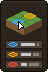

# consts-Destination

RuneLite plugin for Old School RuneScape ( OSRS ): where you're about to act, and where you acted. Anything under your cursor that you can do something with lights up in blue - the tile, or the NPC, player, object or ground item on it. Click, and what you clicked turns orange and stays that way until you're done: the tile you're walking to, or what you're interacting with.

## What it does

- **Hover**: the tile under your cursor is outlined blue and follows the mouse. Over an NPC, a player, an object or a ground item, that thing is outlined blue instead - red if your click would attack it.
- **Clicked**: click a tile to walk there and it turns orange while you walk. Click an NPC, a player, an object or an item and its outline flashes white, then stays orange - red in a fight - while you're interacting with it.
- **Cleared**: walking somewhere else, using an item, getting there, or logging out clears it.

## Settings

The tile in RuneLite's sidebar opens these settings in a panel of their own, the same as the plugin's page in the Configuration panel, so they're one click away while you play. Right-click a setting's name to reset it.

| Section | Setting | What it does | Default |
|---|---|---|---|
| Colors | Hover Color | The tile under your cursor, and anything you hover | Blue `#3EAAFF` |
| Colors | Clicked Color | The tile you're walking to, and what you're interacting with | Orange `#FFA500` |
| Colors | Attack Color | An NPC you're about to attack, or attacking | Red `#FF4632` |
| Tiles | Hover Tile / Clicked Tile | Turn either tile off | On |
| Tiles | Border Width | Tile outline thickness in pixels | `2` |
| Tiles | Fill Opacity | Tile fill: 0 is outline only, 255 is solid | `30` |
| Outlines | On Hover / On Interact | Turn either kind of outline off | On |
| Outlines | NPCs / Players / Objects / Ground Items | Which things get outlined | All on |
| Outlines | Width / Feather | Outline thickness, and how much of it fades out (0 to 4) | `4` / `4` |

## Credits

The outlines are RuneLite's [Interact Highlight](https://github.com/runelite/runelite/tree/master/runelite-client/src/main/java/net/runelite/client/plugins/interacthighlight) by Adam (BSD 2-Clause, Copyright (c) 2021, Adam), folded into consts-Destination: you can turn that plugin off and run this one alone. The ported files, `InteractTracker.java` and `ConstsDestinationOutlineOverlay.java`, keep its license header and license, reproduced in [NOTICE](NOTICE). The sidebar panel is RuneLite's [Configuration panel](https://github.com/runelite/runelite/tree/master/runelite-client/src/main/java/net/runelite/client/plugins/config) by Adam (BSD 2-Clause), cut down to consts-Destination's own settings: `ConfigSidePanel.java` keeps its license header and license, in the same NOTICE. The rest of consts-Destination is [MIT](LICENSE).

## Running it

From the repo root: `./run.sh all` loads every plugin in this repo, consts-Destination included. Setup, including the one-time Jagex account step, is in the [root README](../README.md#run-it).
