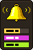
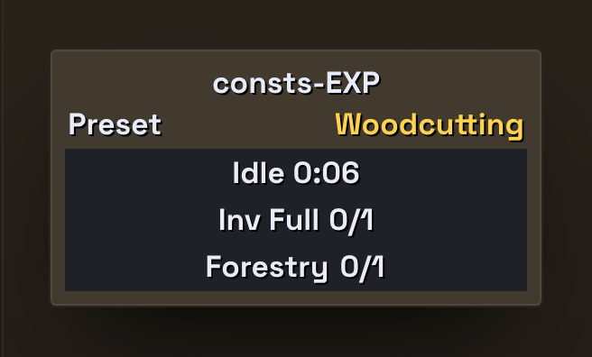
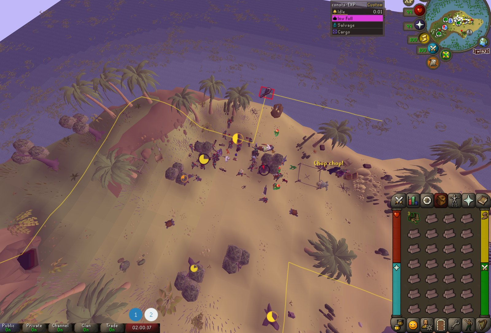
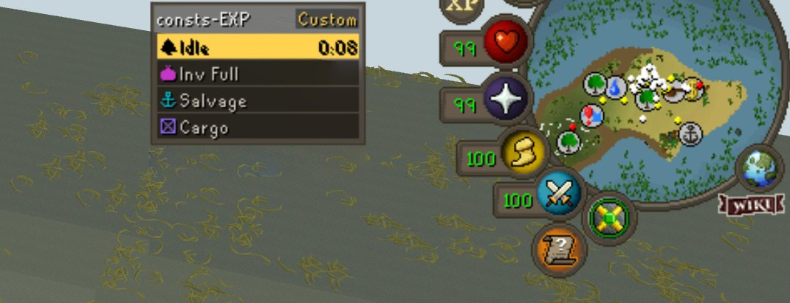
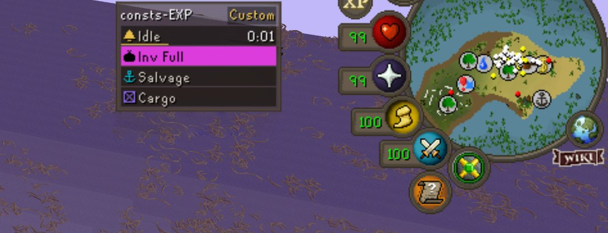
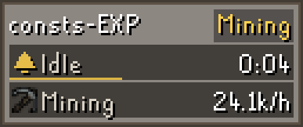
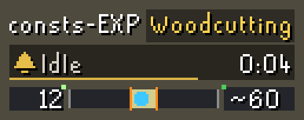

# consts-EXP

RuneLite plugin for Old School RuneScape ( OSRS ), the all-in-one XP helper. Today that's AFK alerts, with presets for chinning, crabbing, mining, woodcutting, fishing and salvaging, XP per hour for the skill you're training, a tick pendulum for tick-perfect clicking, a timer on each tree, and Stealing Artefacts' two guards. Each alert beeps, flashes the screen in its own color, and shows up as a bar in a top-right status panel. Pick a preset and only the alerts you need are on.

| Idle | Inventory full |
|---|---|
|  |  |

Formerly **consts-AFK**, and before that **AFK Alerts**. 2.0.0 starts fresh: every setting is back at its default, and the saved aggro area is gone.

## Presets

The **Preset** dropdown sits at the top of the plugin config, under the Master Switch, and at the top of the **Alerts** tab in the sidebar panel (the EXP icon). You can also Shift + right-click the status panel and choose `Preset: …`.

| Preset | Alerts on |
|---|---|
| Custom (default) | Whatever each alert's own on/off says |
| Chinning | Health, Prayer, Potion, Aggro, Logout |
| Crabbing | Health, Idle, Aggro, Logout, Potion |
| Mining | Idle, Inventory Full |
| Woodcutting | Idle, Inventory Full, Forestry |
| Fishing | Idle, Inventory Full |
| Salvaging Active | Inventory Full, Salvage |
| Salvaging AFK | Cargo Hold only |

Cannon and Random aren't in any preset; turn them on under **Custom**.

Every preset holds Idle while your character is animating, so a long chop or a slow catch doesn't ding you mid-action; an hourglass on Idle's row in the status panel shows it's waiting. Under **Custom**, **Suppress While Animating** (Alerts → Idle, on by default) decides.

Presets only choose which alerts are on. Thresholds, colors and Dismiss on Click always come from your settings. A preset overrides each alert's Enabled; switch back to **Custom** and your own set comes back, as you last left it.

## Settings

The EXP icon in RuneLite's sidebar opens these settings in a panel of their own, the same as the plugin's page in the Configuration panel, so they're one click away while you play. It keeps up with the config: pick a preset from the status panel's Shift + right-click menu and the **Preset** dropdown here shows it. The preset decides which alerts are on; an alert's own **Enabled** only counts under **Custom**. Right-click a setting's name to reset it.

The switch beside the panel's title is the **Master Switch** (first in the plugin config too). Off silences consts-EXP, with no alerts, no status panel, no area lines and no tree timer, without turning the plugin off, so the EXP icon stays in the sidebar. Turning it back on starts fresh, as logging in does, except XP per hour, which lasts until you log out.

Under the title, four tabs split the settings: **Alerts**, which the panel opens on, **Skills**, **Tick & XP** and **General**. Each tab shows only its own sections. Alerts' and Skills' sections start folded, and Tick & XP's and General's start open (Tick & XP opens with the XP table first); click a header to open or fold one. General ends with **Reset**, which puts every setting back to its default. RuneLite's Configuration panel shows the same sections in one list, in this order.

| Tab | Sections |
|---|---|
| Alerts | Preset, then one section per alert: Health, Prayer, Aggro, Potion, Cannon, Idle, Logout, Inventory Full, Random Event |
| Skills | Woodcutting (the Forestry alert, with a checkbox per event, then Tree Timer), Sailing: Salvage, Sailing: Cargo Hold, Thieving (Guard Lures) |
| Tick & XP | The XP table, then XP per Hour (Enabled), Tick Pendulum (Enabled, Rhythm, Your Ping) |
| General | Timing (Click Pause, Quiet After Dismiss, Give Up After, Startup Delay), Sounds (Enabled, Sound, Custom Sound ID, Volume, Repeat Interval), Screen Flash (Enabled, Interval, Opacity) |

Every alert's section has the same items in the same order: **Enabled** (read only by **Custom**), **Dismiss on Click**, **Color**, then its own options.

**Custom remembers.** Switching from Custom to a preset saves every alert's Enabled; switching back puts them back exactly, even if you flipped some while a preset was on.

**Dismiss on Click** (on by default): a click or key press silences the alert. A one-off alert is cleared; an ongoing one (Health, Prayer, Idle, Aggro) holds off for the Click Pause. Turn it off for alerts you never want a stray click to hush. Logout has none: any click restarts its countdown.

## Alerts

| Alert | Fires when | Stops when | Default color |
|---|---|---|---|
| Health | HP below threshold (`25`) | HP recovers | Green |
| Prayer | Prayer below threshold (`20`) | Prayer recovers | Blue |
| Idle | No movement, new animation, combat or XP for `6 s` | Activity resumes | Yellow |
| Aggro | The game's 10-minute aggro timer runs out (or a custom interval), tracked like RuneLite's NPC Aggression Timer: see [Aggro area](#aggro-area) | You leave the area or Shift + right-click → Reset Aggro Timer | Red |
| Logout | No click/key for `24 min` | You click or press a key | Orange |
| Potion | Chat: `… is about to …` (potion/effect expiry) | A click, or Give Up After | Black |
| Random | A random event NPC targets you: yours only, not someone else's nearby (`20 s` cooldown) | A click, or Give Up After | White |
| Cannon | Chat: `Your cannon is out of ammo!` | A click, or Give Up After | Dark orange |
| Inventory Full | Chat: `Your inventory is too full to hold any more …` | A click, or Give Up After | Magenta |
| Salvage | Chat: `You salvage all you can from the shipwreck…` or `You have no more salvage to sort…` | A click, or Give Up After | Cyan |
| Cargo Hold | Chat: `…cargo hold is full` (e.g. `Your crewmate on the salvaging hook cannot salvage as the cargo hold is full.`) | A click, or Give Up After | Violet |
| Forestry | A Forestry event you picked starts nearby | A click, or Give Up After | Lime |

"A click" means with **Dismiss on Click** on. **Give Up After** (General → Timing, `2 min`) ends a one-off alert nobody clicks away.

### Aggro area

In **OSRS** mode (the default), Aggro follows the game's own rule, the way RuneLite's NPC Aggression Timer does:

- The game remembers two tiles, each with a 21×21 area around it. While you stay within 10 tiles of either one, the 10-minute timer keeps running. Step outside both and the older tile moves to where you stand: NPCs are aggressive again for another 10 minutes.
- **Area lines** outline the area on the ground: translucent yellow while NPCs are still aggressive, solid yellow once they've stopped. Walk past them to reset the timer. **Show Area Lines** (on), **Aggressive Color** and **Unaggressive Color** are at the end of the section (Alerts → Aggro). The lines only show while the preset, or Custom, has Aggro on.
- **Finding the area.** Until consts-EXP knows where both tiles are (right after you turn it on, or after logging in somewhere new), the row reads `Aggro ?`. Teleport or take a dungeon entrance: that leaves both areas, so the timer starts and one area is known (`Aggro ? 9:59`). Walk out of it once and the second is known too, and the `?` goes away. Going back near where you teleported from before then makes it unknown again. Or Shift + right-click the panel → **Reset Aggro Timer** to start a fresh area where you stand.
- **Logging out** saves the area and the time left for that account. Log back in on the same tile and Aggro carries on; anywhere else it starts over, unknown.

In **Custom Minutes** mode Aggro is a plain repeating timer, with no area and no lines.

### Forestry events

Each event has its own checkbox (Skills → Woodcutting), all on by default: Rising Roots, Struggling Sapling, Flowering Tree, Woodcutting Leprechaun, Beehive, Friendly Ent, Poachers, Pheasant Control and Enchantment Ritual. Untick the ones you don't care for.

An event is spotted by the NPCs or objects that mark it, the same ones RuneLite's own Woodcutting plugin uses. It alerts once per event: more entlings, a withering sapling or a loading screen don't set it off again. While it fires, the status panel names it, e.g. `Forestry Leprechaun`. Pheasant Control's Freaky Forester no longer counts as a random event.

### AFK salvaging with crew

1. Put two crewmates on salvaging hooks at a shipwreck.
2. Pick **Salvaging AFK**.
3. When the hold fills, the crew's chat message starts the Cargo Hold alert. Click anywhere to silence it, then empty the hold.

The crew message arrives as a filtered (spam) game message; consts-EXP listens on that channel.

## XP per hour

On by default (**Tick & XP** → **XP per Hour** → **Enabled**). Once you gain XP, a row under the alerts shows your XP per hour in the skill you're training: the last one to gain XP. Hitpoints and Slayer come with combat XP, so they only show when no other skill has gained any. Hover the row for the XP gained and the time behind the rate.

- **The rate** is the XP since the skill's first drop over the time since that drop, so steady drops give their true rate from the second one on. It keeps falling while you're away, which is what the reset is for.
- **The Tick & XP tab** opens with a table of every skill trained since you logged in, newest first: its icon, XP/h, XP gained and time, and a **Reset** for each. **Reset all** under it resets every skill.
- **Reset** sets a skill back to zero, for after a break; its clock starts again at its next drop. There's no undo. Shift + right-click the status panel and pick **Reset XP/h** to reset every skill from the game.
- **Logging out** clears it; hopping worlds and loading screens don't.

## Tick pendulum

Off by default: turn it on under **Tick & XP** → **Tick Pendulum** → **Enabled**. It sits in the status panel under the alerts and XP per hour, as wide as their bars.

- **The ball** crosses the track once a tick, left to right, then back. Each swing is one tick's click window: every click made during it is read by the server on the same tick.
- **Click while the ball is between the two orange lines.** The space between them glows while it's time. The middle of the swing is the safest click, as far as it gets from both cutoffs.
- **Every click** washes the track: bright green in the zone (perfect, with a green pip on the count), green elsewhere in the swing, red when it broke the rhythm.
- **Left:** your ticks in a row. It hops yellow as it goes up, and flashes red and drops to 0 when a swing goes by without its click.
- **Right:** the ping the pendulum follows. `~` means it's learned. The dot is green under 80 ms, yellow to 150 and orange above, and swells when your clicks correct it.
- **Late ticks:** the ball waits where the tick will show and goes on when it comes.

**Rhythm** picks what a swing wants: **Single click** (2-tick teaks, cooking, bloodwood), **Flick** (two clicks in one swing, like a prayer flick, with a wider zone), or **Every other swing** (2-tick harpooning: only the swing your hitsplat shows in takes a click, and the other is dimmed).

**Your ping.** RuneLite can't tell a plugin your ping, so the pendulum learns where the click cutoff is from your prayer and run toggles. When one shows its result a tick later than the pendulum expected, or sooner, the cutoff moves to that click. Each world region starts from a guess (60 ms, plus the server's time for the world's player count), and keeps what it learned for the session. Skilling clicks don't teach it anything. If you know your ping, set **Your Ping**, and the pendulum follows that instead.

## Tree timer

A pie on each tree empties as the tree nears falling, ported from Tree Despawn Timer by Jason O'Neill. It isn't an alert and never beeps. It shows whenever **Tree Timer** (Skills → Woodcutting, on by default) is on, whatever the preset, unless the Master Switch is off. Run it instead of that plugin, not beside it, or each tree gets two.

- **How it counts.** Under Forestry a tree has hidden health. It only starts going down once someone takes a first log. Then it drops by one every game tick (0.6 s) while anyone chops the tree, and climbs back by one every tick while nobody does. Chopping alone, the timer waits for your first log; anyone else chopping is taken to have had theirs. A full tree lasts as long as the OSRS Wiki says: an oak 27 s, a yew 1:54, a magic tree 3:54, a redwood 4:24.
- **The pie** turns from green to yellow, orange and red as the tree runs low.
- **When it shows nothing.** If the tree was already being chopped when you got there, how long it has left can't be known, so it gets no pie at all. Trees in Miscellania and Etceteria never get one: the kingdom's trees there can't be cut down.
- **Trees**: oak, willow, teak, maple, hollow, mahogany, arctic pine, yew, camphor, magic, ironwood, redwood and rosewood.
- It's an estimate. A tree can fall with a little pie left, or stand a moment past empty until someone takes another log; either way it shouldn't be off by more than a few seconds. Hopping worlds or logging in starts every tree over.

## Stealing Artefacts

In Port Piscarilius, two rows in the status panel, under the alerts, show whether the guards are lured: **East guard** and **SE guard**, each with a green tick once it's lured and a red cross while it isn't. A guard counts as lured while it stands on its post facing south (the east one) or west (the south-east one). Each row keeps what it last saw on the post, so it holds while you're in a target house and the guard is out of sight; a hop or a logout sets both back to a cross. That's the one part of pajlads' Stealing Artefacts that comes over: no target house, patrol highlights or Captain Khaled. It isn't an alert and never beeps. **Guard Lures** (Skills → Thieving, on by default) turns it off; the Master Switch hides it too. Run it instead of the Hub's Stealing Artefacts, not beside it.

## Training guide

Where each preset shines, what its alerts are telling you, and what to tune.

### Chinning

- **Where:** Maniacal monkeys in Kruk's Dungeon, after Monkey Madness II. Grey, red or black chinchompas by Ranged level.
- **What the alerts mean:** Aggro says the monkeys have stopped being aggressive after ten minutes: run out past the area lines and back. Health and Prayer catch you before you run low. Potion says your Ranging potion is wearing off. Logout keeps you from getting logged out.
- **Tune:** Set Health and Prayer thresholds to where you would drink, and turn off Dismiss on Click for both so a stray click can't silence them.

### Crabbing

- **Where:** Sand crabs on Crabclaw Isle or the Hosidius coast, ammonite crabs on Fossil Island, rock crabs near Rellekka. Stand where two or three crabs can reach you.
- **What the alerts mean:** Aggro is the one that matters: after ten minutes the crabs stop attacking. Leave the area, past its lines, and come back, and the timer resets itself. Health tells you to eat; Idle means everything around you is asleep or dead.
- **Tune:** At low levels raise the Health threshold to about half your Hitpoints. No Prayer here, so a low Prayer level never beeps.

### Mining

- **Where:** Rocks that last: amethyst in the Mining Guild (92 Mining), or pay-dirt in the Motherlode Mine (30 Mining).
- **What the alerts mean:** Idle fires when your rock or vein runs out. Inv Full says it is time to bank or fill the hopper.
- **Tune:** If the pauses between ores trip Idle, raise its time a little.

### Woodcutting

- **Where:** Chop where other people chop: Forestry events turn up more often with company, and pay out anima-infused bark for Forestry rewards. Long-lived trees like teaks, mahogany or redwoods keep you going.
- **What the alerts mean:** Forestry flashes lime and names the event, so you can tell a Leprechaun from an Ent at a glance. Idle fires when your tree falls; Inv Full when it is time to bank. The pie on each tree is the [tree timer](#tree-timer): when yours runs low, pick the next tree.
- **Tune:** Untick the Forestry events you would rather chop through. One alert per event, however many entlings show up.

### Fishing

- **Where:** Spots you can sit at: barbarian fishing at Otto's Grotto, or any spot where you drop fish as you go.
- **What the alerts mean:** Idle fires when the spot moves, and when your inventory fills, since you stop fishing either way. Inv Full too, when the game says so.
- **Tune:** Nothing to tune for most spots.

### Salvaging Active

- **Where:** Working a salvaging hook at a shipwreck yourself.
- **What the alerts mean:** Inv Full says it is time to sort. Salvage fires when you have nothing left to sort, or the wreck is picked clean: back to the hook, or on to the next one.
- **Tune:** Click the Inv Full alert away and start sorting: Quiet After Dismiss (General → Timing, 60 s) keeps it from starting again while the message repeats. Raise it if sorting takes longer.

### Salvaging AFK

- **Where:** Two crewmates on salvaging hooks at a shipwreck, and you somewhere else.
- **What the alerts mean:** Only Cargo: when the hold fills, the crew says so in chat and the screen goes violet. Click to silence it, then empty the hold.
- **Tune:** Nothing. It is one alert on purpose.

### Custom

- **Where:** Anything the presets don't cover, including a cannon and random events.
- **What the alerts mean:** Each alert's own Enable toggle decides. Cannon and Random are only here.
- **Tune:** Switching to a preset never touches your Custom toggles, so you can always come back.

## Shared behavior

- **Click Pause** (`3 s`): every click or key press silences the alerts that Dismiss on Click, and clears any one-off alert that does.
- **Quiet After Dismiss** (`60 s`): a one-off alert you click away ignores its own trigger for this long, so a repeating message doesn't start it again while you sort, bank or drop.
- **Give Up After** (`2 min`): a one-off alert nobody clicks away stops on its own.
- **Startup Delay** (`8 s`): nothing fires right after the plugin starts.
- **Loading screens** (teleports, region changes) don't reset timers or running alerts. Logging out stops running alerts and starts the timers over, except Aggro in OSRS mode: its area and time left are saved per account and carry on if you log back in where you logged out.
- **Sound**: the system beep by default. **Sound** (General → Sounds) swaps it for one of the game's own sounds (town crier bell, Grand Exchange offer, coins, prayer drained, teleport, tree falling, boop, anvil), or **Custom sound ID** plays any game sound effect by its id. Picking one plays it once. **Volume** (`96` of `127`) plays it even with the game's sound effects off. `Repeat Interval` (`1.2 s`) sets the gap between sounds.
- **Status panel**: the title, with the active preset as a tag beside it, or on a line of its own when it doesn't fit, as both Salvaging presets do. Then one row per enabled alert: its icon, name and value (hover for details). A quiet row stays dark, with a thin line under it: Idle's fills toward its threshold, Logout's toward its warning and Aggro's toward running out, and Health's and Prayer's show your level. A firing row lights up in its color, and pulses with the screen flash while it flashes. A color too dark to show well on the panel, like Potion's default black or a deep blue, is lightened toward white there; the screen flash keeps it as it is. An hourglass on Idle's row means it's waiting for your animation to stop. Under the alerts come XP per hour, the tick pendulum when it's on, and the pause countdown. Shift + right-click the panel for its menu. It's drawn in RuneScape's small font, whatever RuneLite's interface font is set to.

## Running it

From the repo root: `./run.sh all`. Setup, including the one-time Jagex account step, is in the [root README](../README.md#run-it).

## Credits

Aggro's OSRS mode, its area tracking and its area lines are ported from RuneLite's [NPC Aggression Timer](https://github.com/runelite/runelite/tree/master/runelite-client/src/main/java/net/runelite/client/plugins/npcunaggroarea) by Woox (BSD 2-Clause, Copyright (c) 2018, Woox). The ported files, `AggroArea.java` and `ConstsExpAggroAreaOverlay.java`, keep its license header and its BSD 2-Clause license, reproduced in [NOTICE](NOTICE). The sidebar panel is RuneLite's [Configuration panel](https://github.com/runelite/runelite/tree/master/runelite-client/src/main/java/net/runelite/client/plugins/config) by Adam (BSD 2-Clause), cut down to consts-EXP's own settings: `ConfigSidePanel.java` keeps its license header and license, in the same NOTICE. The tree timer is [Tree Despawn Timer](https://github.com/CreativeTechGuy/tree-despawn-timer) by Jason O'Neill (BSD 2-Clause, Copyright (c) 2023, Jason O'Neill), from commit `9f9eb2b`, cut down to its pie: `TreeTimer.java`, `TreeTimerState.java`, `TreeTimerTree.java` and `ConstsExpTreeTimerOverlay.java` keep its license header and license, in the same NOTICE. The guard check is [Stealing Artefacts](https://github.com/pajlads/StealingArtefacts) by Christopher Bitler (MIT, Copyright 2020 Christopher Bitler), from commit `631227f`, cut down to its two guards: `GuardLures.java` keeps its license, in the same NOTICE. The rest of consts-EXP is [MIT](LICENSE).
