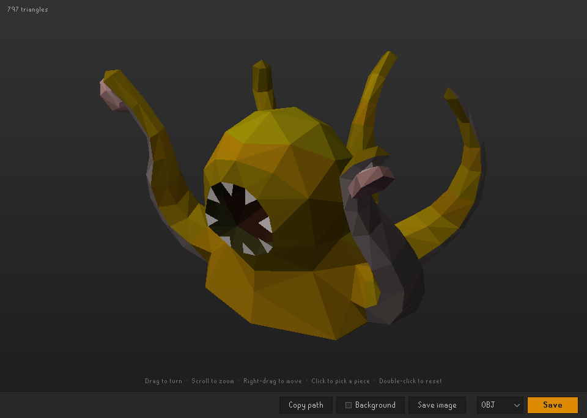

# consts-Models

RuneLite plugin for Old School RuneScape ( OSRS ): export any model in the game, or the area around you. Right-click anything and pick **Export Model**, turn it in a viewer, and save it as OBJ, PLY or GLB for Blender and other 3D software. A player, NPC or pet comes with its animations.

## What it does

- **Export Model**: on the right-click menu of players, NPCs, pets, objects (walls and decorations included) and items on the ground. It sits low in the menu, below Examine or a player's options, so it's never the left click.
- **Items**: right-click an item in the inventory, bank or equipment tab, or anywhere else it has an Examine, and pick Export Model to get its model without dropping it. A noted item or a bank placeholder gives the item itself.
- **Yourself**: right-click the inventory or equipment tab and pick Export Model, or press **Export yourself** in the sidebar: your player, gear and all, as you look now.
- **Capture area**: a sidebar button that captures everything around you as one model: the ground as a block with a flat bottom, and the objects, walls, ground items, NPCs and players standing on it. It reaches the Area radius each way, so the default 6 covers 13 × 13 tiles.
- **Animations**: Export Model on a player, NPC or pet, and Export yourself, also capture its idle, turns, walks and run, frame by frame, as the game times them. The viewer's corner counts them after the triangles, such as "2 animations". Something in the middle of an action, such as fighting or skilling, comes without them: capture it again once it stands idle. The game lists no other animations for an NPC, so attacks and deaths can't be captured.
- **Viewer**: each capture opens in a window of its own. Drag to turn it, scroll to zoom, right-drag or Shift-drag to move it, and double-click or press R to see all of it again.
- **Pieces**: click a piece of the model to pick it, and it lights up orange. **Remove piece** (or Delete) takes it out of the view and the saved file, such as a flat shadow under an object. **Bring back** puts every piece back, and Escape lets go.
- **Save**: the bar along the bottom saves the model as OBJ, with its colors in an MTL file beside it, as PLY, with a color on every corner, or as GLB (glTF), with its animations (Cmd/Ctrl+S). Blender's own importer opens a GLB with each frame a shape key and each animation an action, ready to play. Files keep the game's units, 128 to a tile. **Save image** saves the view as a PNG on its **Background**: the viewer's own, black, a grey, white, a green or blue screen, sky, sand or any color.
- **Captures**: the sidebar lists every capture, newest first, on two tabs: **Session**, and **All models**, kept from one session to the next. Click one to open it again; its trash can deletes it at once. Files you saved from the viewer stay.

## Where files go

- **The plugin's folder**: `~/.runelite/plugin-data/consts-models`, where RuneLite keeps the plugin's files. The models and pictures you save go there, and every capture the sidebar keeps goes in its `captures` folder.
- **Choose folder**, in the sidebar, saves models and pictures to a folder you pick, until RuneLite closes. RuneLite lets a plugin keep a folder you pick for one session only, so after a restart they go to the plugin's folder again. Captures always stay in the plugin's folder.
- **Copy path**, in the sidebar or the viewer, copies the folder's path: the Plugin Hub doesn't let a plugin open Finder or File Explorer. Paste it in Finder's Go to Folder (Cmd+Shift+G) or File Explorer's address bar.
- **Before 1.1**, files went to `~/.runelite/consts-models`. The first time 1.1 starts, RuneLite moves that folder, captures and all, to `~/.runelite/plugin-data/consts-models`. Files saved to a folder you chose stay where they are.

## Settings

At the bottom of the sidebar panel, under **Settings**, closed until you click it, and under the wrench, in the plugin's page of the Configuration panel. A change in either shows in the other.

| Setting | What it does | Default |
|---|---|---|
| Save as | The format the viewer picks first: OBJ, PLY or GLB | OBJ |
| Area radius (tiles) | How far Capture area reaches from you each way, 1 to 24 | 6 |
| Only with Shift | Show Export Model on the right-click menu only while Shift is held | Off |

## Credits

Exporting is built on the Plugin Hub's [Model Exporter](https://github.com/Bram91/Model-Dumper) by Bram91 (BSD 2-Clause): how a model's faces get their colors, a texture's average color among them. The game's colors become RGB through RuneLite's [JagexColor](https://github.com/runelite/runelite/blob/master/cache/src/main/java/net/runelite/cache/models/JagexColor.java) by Abex (BSD 2-Clause). The ported files, `ModelCapture.java`, `TextureColors.java` and `JagexColor.java`, keep that license, reproduced in [NOTICE](NOTICE); the rest of consts-Models, its viewer and icons included, is [MIT](LICENSE).

## Running it

From the repo root: `./run.sh all` loads every plugin in this repo, consts-Models included. Setup, including the one-time Jagex account step, is in the [root README](../README.md#run-it).
