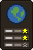
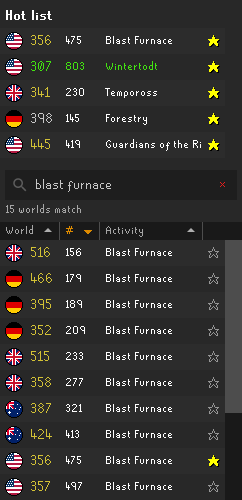
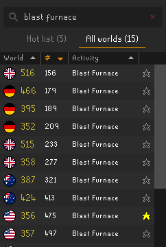

# consts-World

RuneLite plugin for Old School RuneScape ( OSRS ): a world switcher in the sidebar that opens on your hot list. Star the worlds you hop between once, in All worlds, and after that the hot list is all you see: click a world in it to hop there. It also brings you back to the world you were last on when RuneLite starts.

## What it does

- **Two tabs**: Hot list and All worlds, each named with how many worlds it shows. The panel always opens on the hot list. The hot list starts empty and is saved with your RuneLite settings.
- **Hop**: click a world in the hot list to hop there; on the login screen, the click picks that world instead. In All worlds, double-click a world, as in RuneLite's World Hopper. The world you're on is green.
- **Back where you were**: consts-World remembers the world you were last logged in to, hops included, and when RuneLite starts it puts the login screen on that world, so you log back in where you left off. It skips beta worlds. If you've set a world in RuneLite's Default World plugin, turn that off: both pick the login screen's world.
- **Stars**: the star at the end of a row adds that world to the hot list, or removes it once it's filled. A row's right-click menu does the same.
- **Search**: the box at the top searches the tab that's showing, and starts empty on each tab. Each word you type has to start one of a world's words: its activity (`wintertodt`, `blast`, `tempoross`), its number (`330`), its region (`uk`, `germany`, `us`, `aus`) or `members`, `p2p`, `free` or `f2p`. So `skill total 2000` finds the 2000 total level worlds, and `members uk` the UK members worlds.
- **Sort**: click World, # (players) or Activity to sort the tab, and again to flip it. Worlds without an activity stay at the bottom, and total level worlds sort by their numbers: 500 before 1250. Right-click a heading to refresh the worlds.

There are no settings.

## Credits

The panel and the hopping are RuneLite's [World Hopper](https://github.com/runelite/runelite/tree/master/runelite-client/src/main/java/net/runelite/client/plugins/worldhopper) plugin by Adam, Lotto, gregg1494 and Psikoi (BSD 2-Clause), cut down to its panel with a hot list in place of its favourites: no quick-hop keys, pings, filters or Hop-to option. You can run both. The return to your last world is from RuneLite's [Default World](https://github.com/runelite/runelite/tree/master/runelite-client/src/main/java/net/runelite/client/plugins/defaultworld) plugin by Tomas Slusny (BSD 2-Clause). The ported files, `ConstsWorldPlugin.java`, `ConstsWorldPanel.java`, `WorldRow.java` and `WorldTableHeader.java`, and the flags and arrow they use keep that license, reproduced in [NOTICE](NOTICE); the rest of consts-World, its star and globe icons included, is [MIT](LICENSE).

## Running it

From the repo root: `./run.sh all` loads every plugin in this repo, consts-World included. Setup, including the one-time Jagex account step, is in the [root README](../README.md#run-it).
